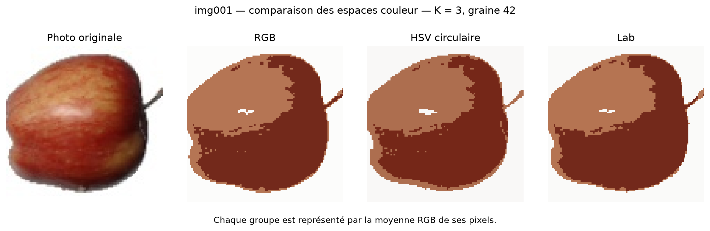
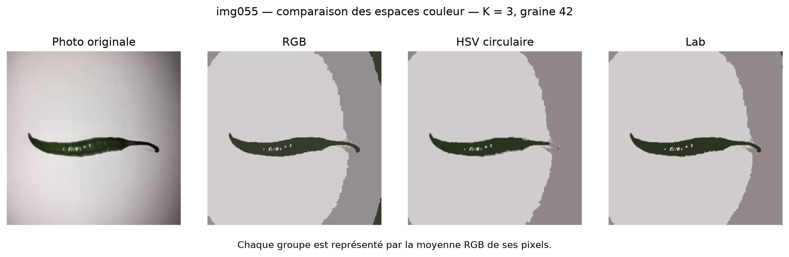
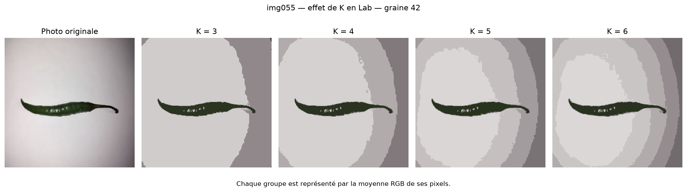
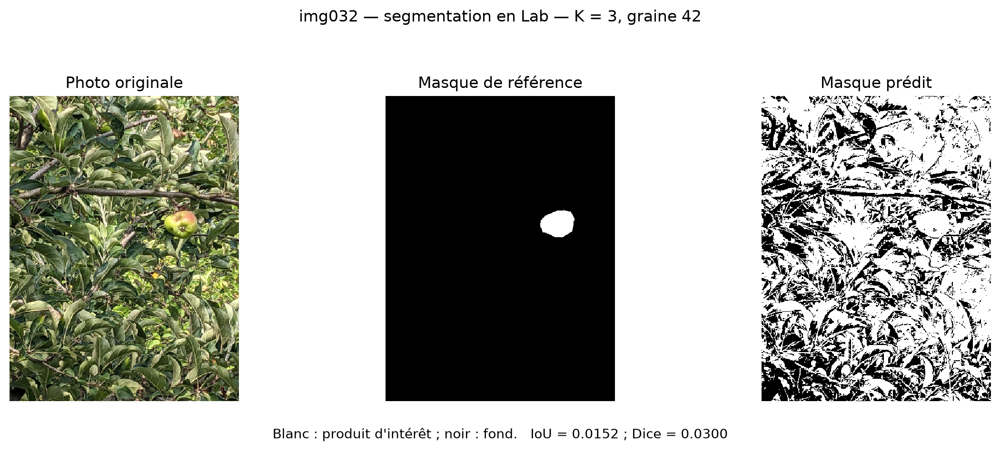
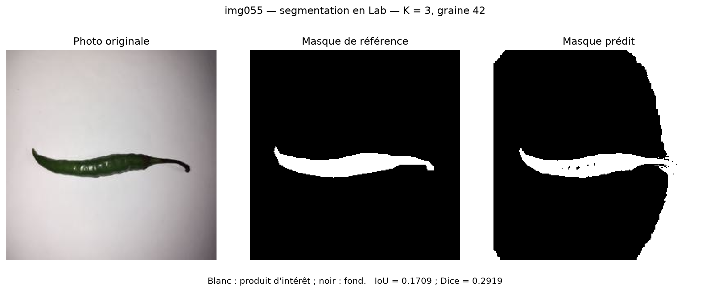
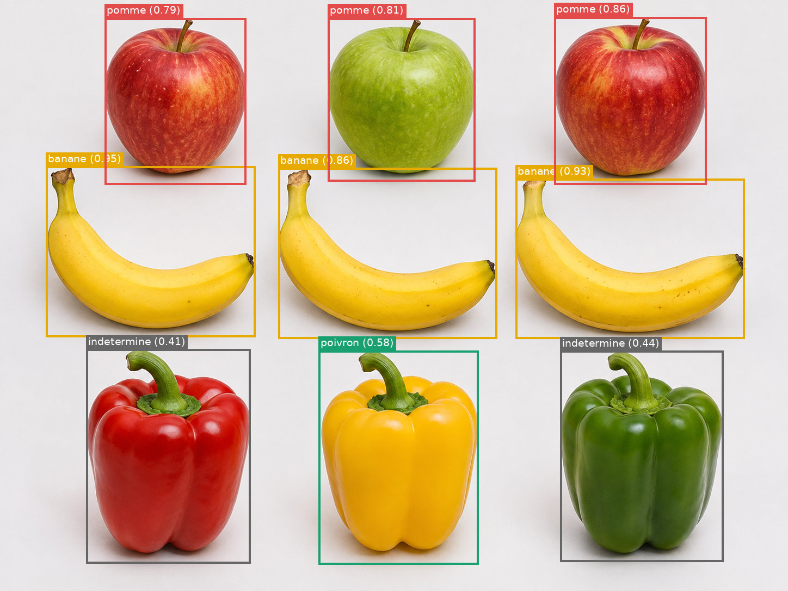
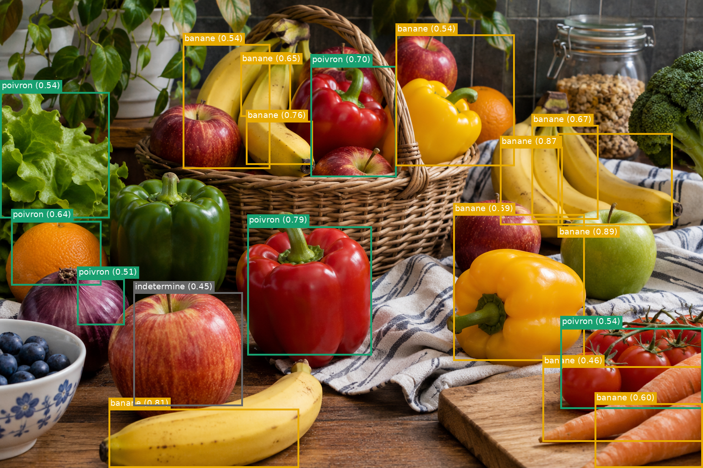
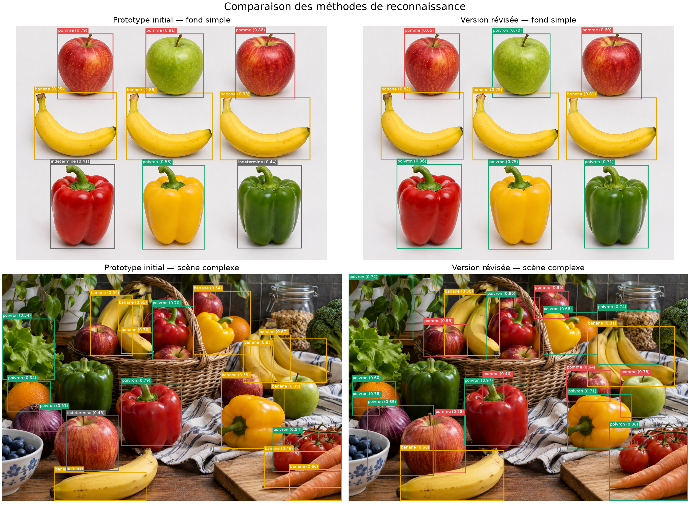

# Rapport — Segmentation et reconnaissance de fruits

Étude K-means et extension de reconnaissance supervisée — résultats disponibles au 19 novembre 2026.

## 1. Objectif et périmètre

Dans le contexte d'une caisse automatique, reconnaître des produits sans code-barres demande d'abord de distinguer leurs régions visibles du fond. Ce projet étudie cette segmentation à partir de la couleur, sur des pommes, des bananes, des poivrons et des piments.

Trois représentations sont comparées avec K-means : **RGB, HSV circulaire et Lab**, pour **K = 3, 4, 5 et 6**. Les questions étudiées sont l'effet de l'espace couleur, l'effet du nombre de groupes et les limites liées au fond et à l'éclairage.

La partie K-means produit des groupes de pixels et un masque binaire « produit / fond ». Les numéros de groupes sont arbitraires et peuvent changer d'une expérience à l'autre. **Une extension supervisée attribue ensuite les catégories pomme, banane et poivron aux régions localisées** ; son protocole et ses limites sont décrits en section 9.

## 2. Données, partitions et annotations

L'inventaire [metadata.csv](data/metadata.csv) de l'étude K-means contient **51 images**. Leur répartition est la suivante :

| Source | Images | Mise au point | Évaluation |
| --- | --- | --- | --- |
| Fruits-360 : images simples | 30 | 20 | 10 |
| Fruits-360 : scènes multiples | 18 | 13 | 5 |
| Kaggle : Agricultural crops image classification | 1 | 0 | 1 |
| Kaggle : Chili Plant Disease Detection | 2 | 2 | 0 |
| **Total** | **51** | **35** | **16** |

Les 30 images simples comprennent 10 pommes, 10 bananes et 10 poivrons. Les 18 scènes Fruits-360 multiples comprennent 5 scènes de pommes, 5 de bananes, 5 de poivrons et 3 scènes mélangées. Une image de bananier et deux piments complètent le jeu. Certains mélanges contiennent aussi du citron ou de la grenade : le jeu ne se limite donc pas à trois catégories pures.

Les images individuelles Fruits-360 présentent un fond blanc préparé. Les scènes multiples comprennent notamment des étals, de la végétation et des fonds sombres. Les ajouts Kaggle élargissent les conditions étudiées et introduisent une variabilité de domaine par rapport aux photographies de supermarché.

Les sources renseignées dans les métadonnées sont le [dépôt Fruits-360 100×100 des auteurs](https://github.com/fruits-360/fruits-360-100x100), le [dépôt Fruits-360 multi](https://github.com/fruits-360/fruits-360-multi) et les jeux Kaggle [Agricultural crops image classification](https://www.kaggle.com/datasets/mdwaqarazam/agricultural-crops-image-classification) et [Chili Plant Disease Detection](https://www.kaggle.com/datasets/shuvokumarbasak4004/chili-plant-disease-detection). Les références des fichiers Fruits-360 sont fixées aux commits `bed1c24ee70de1569272de3882fbde88211c08b5` et `11c28e82a7400ce1596885514f8f0c3c7493f01c` dans l'inventaire. La licence Fruits-360 est renseignée comme **CC BY-SA 4.0**. La licence des trois ajouts Kaggle est **non renseignée (`NULL`)** ; les informations disponibles ne permettent pas d'en établir les conditions de réutilisation.

La partition distingue **35 images de mise au point** et **16 images d'évaluation**. Aucun `scene_id` de l'inventaire ne traverse ces deux partitions. Cette vérification ne démontre toutefois pas l'indépendance de toutes les vues d'un même objet physique.

La liste [annotation_selection.txt](data/annotation_selection.txt) contient **15 images annotées avec LabelMe** : 10 de mise au point et 5 d'évaluation. Les polygones nommés `fruit` décrivent les parties visibles des produits. Les masques PNG sont construits à la résolution préparée par [create_masks.py](src/create_masks.py) : le fond est rempli de **0**, puis les polygones de **255**. Pour les calculs, ils deviennent booléens avec `reference_mask > 0`.

Les cinq références finales sont **img007, img009, img020, img027 et img041**. Les autres images d'évaluation ne disposent pas de masque manuel dans cette sélection et ne contribuent donc pas aux scores IoU/Dice finaux.

## 3. Protocole expérimental

### 3.1. Prétraitement commun

Le code [preprocessing.py](src/preprocessing.py) applique le même traitement avant les trois représentations :

1. Lecture de l'image et correction de son orientation EXIF.
2. Conversion du profil ICC vers **sRGB**, avec l'intention colorimétrique relative, lorsqu'un profil existe.
3. Application de l'hypothèse sRGB en l'absence de profil.
4. Réduction avec LANCZOS, sans changement des proportions, pour limiter le plus grand côté à **512 pixels** ; les petites images ne sont pas agrandies.
5. Enregistrement d'un PNG RGB avec un profil sRGB dans `data/processed`.
6. Conversion des pixels en flottants et division par 255 pour les calculs.

Dans l'implémentation PIL, le redimensionnement précède la normalisation numérique. Le code de segmentation recharge les PNG en `float32` dans `[0, 1]`. L'audit des originaux trouve **9 profils sRGB, 8 profils Display P3 et 34 images sans profil**. L'hypothèse sRGB de ces 34 images constitue une limite documentée. Aucun filtrage ni retrait manuel du fond n'est appliqué aux photos de l'expérience principale.

### 3.2. Représentations des pixels

Une image `H × W × 3` devient une matrice `(H × W, 3)`, avec une ligne par pixel. Les coordonnées spatiales ne sont pas utilisées. Les transformations sont implémentées dans [color_spaces.py](src/color_spaces.py).

| Représentation | Trois caractéristiques utilisées |
| --- | --- |
| RGB | `R`, `G`, `B`, dans `[0, 1]` |
| HSV circulaire | `S × cos(2πH)`, `S × sin(2πH)`, `V` |
| Lab | `L*/100`, `a*/100`, `b*/100` |

L'encodage HSV circulaire est un choix du projet pour rapprocher les teintes situées de part et d'autre de la coupure de H. La saturation réduit le poids d'une teinte peu significative pour un pixel gris. Il ne s'agit pas du K-means sur le triplet HSV brut.

Lab est calculé à partir du sRGB avec **D65 et un observateur de 2°**, conformément aux conventions de [rgb2lab](https://scikit-image.org/docs/stable/api/skimage.color.html#skimage.color.rgb2lab). Diviser les trois composantes par le même facteur conserve leur géométrie euclidienne à un facteur global près. Les valeurs négatives de `a*` et `b*` sont conservées. Aucune standardisation indépendante des canaux n'est ajoutée.

### 3.3. K-means et reconstructions

Les paramètres effectifs de [segmentation.py](src/segmentation.py) sont :

| Paramètre | Valeur |
| --- | --- |
| `n_clusters` | 3, 4, 5, 6 |
| `init` | `k-means++` |
| `n_init` | 10 |
| `max_iter` | 300 |
| `algorithm` | `lloyd` |
| `random_state` | 42 |
| `tol` | 0,0001, valeur par défaut de la version utilisée |

Les dix initialisations sont comparées par l'inertie ; `n_iter_` décrit la meilleure solution retenue, selon le fonctionnement de [KMeans](https://scikit-learn.org/stable/modules/generated/sklearn.cluster.KMeans.html). K-means est ajusté **sur tous les pixels de chaque image séparément**. Le découpage mise au point / évaluation porte sur le choix de la méthode et de ses réglages, et non sur l'apprentissage d'un classificateur global.

Cela produit **51 × 3 × 4 = 612 configurations**, enregistrées dans [global_results.csv](results/tables/global_results.csv), avec 612 cartes `.npy`. Une vérification des cartes retrouve bien K groupes distincts dans chacune des 612 configurations. Le script peut également exporter deux figures par configuration : carte des groupes et reconstruction, soit 1 224 figures de détail. Ces exports reproductibles ne sont plus conservés après nettoyage ; les six figures de synthèse du rapport sont maintenues.

Pour les trois espaces, chaque groupe est reconstruit avec la **moyenne RGB de ses pixels originaux**. Les couleurs affichées sont donc comparables sans inversion de l'encodage HSV circulaire. Une reconstruction à K couleurs ne constitue pas encore un masque fruit/fond.

### 3.4. Passage des groupes au masque prédit

La règle principale, commune aux trois espaces, est définie dans `create_predicted_mask()` de [evaluation.py](src/evaluation.py) :

1. Construction d'une bande sur les quatre côtés, d'épaisseur `max(1, round(0.02 × min(H, W)))`.
2. Comptage des occurrences des groupes dans cette bande, sans duplication des coins.
3. Identification du groupe le plus fréquent comme fond ; en cas d'égalité, sélection du plus petit numéro.
4. Affectation des autres groupes aux produits d'intérêt : `predicted_mask = label_map != background_cluster`.

La bande fait ainsi 2 pixels pour une image 100 × 100 et 10 pixels pour une image 512 × 512. Le numéro du fond peut varier selon l'image et la configuration : le groupe 0 n'a pas de signification fixe. Cette règle suppose qu'un groupe dominant sur le contour représente le fond et que les autres groupes peuvent être conservés. Les références manuelles servent à mesurer son résultat, pas à choisir les groupes pour chaque image.

## 4. Mesures et méthode d'agrégation

| Mesure | Calcul et interprétation |
| --- | --- |
| Inertie par pixel | `model.inertia_ / N`, moyenne des distances au carré aux centres |
| MSE RGB | Moyenne de `(RGB_original − RGB_reconstruit)²` sur les pixels et les trois canaux |
| Silhouette | Séparation des groupes dans la représentation utilisée ; valeurs entre −1 et 1 |
| Durée | Temps de l'appel à `segment_kmeans()`, en secondes |
| IoU | `intersection / union` des pixels de produit |
| Dice | `2 × intersection / (taille_reference + taille_prediction)` |

La silhouette est calculée sur **au maximum 2 000 pixels**, tirés sans répétition avec une graine 42. Les mêmes indices sont utilisés pour les 12 configurations d'une image. Ce sous-échantillonnage ne concerne pas l'ajustement de K-means. Pour chaque pixel, le coefficient compare la distance moyenne à son propre groupe et la plus petite distance moyenne à un autre groupe, selon la [définition de silhouette_score](https://scikit-learn.org/stable/modules/generated/sklearn.metrics.silhouette_score.html). Le calcul n'est effectué que si le nombre de groupes présents est compris entre 2 et le nombre de pixels sélectionnés moins 1.

L'inertie se compare entre K **dans une même représentation**. Même bornée, la silhouette utilise la géométrie de chaque espace ; elle ne suffit pas à classer les méthodes selon la qualité des masques. La MSE apporte une mesure commune de fidélité RGB, mais favorise naturellement l'objectif RGB. Elle ne mesure ni la reconnaissance des produits ni la précision des contours.

L'IoU et le Dice portent sur la classe **produit**, avec des masques booléens de dimensions identiques. Une prédiction vide face à un fruit annoté donne 0. Deux masques vides donnent `NaN`, exclu de la moyenne. Les références utilisées ici sont non vides et tous les scores calculés sont valides.

Les statistiques sont calculées **par image**, puis résumées par configuration : moyenne, écart-type d'échantillon avec le diviseur `n − 1`, et nombre de valeurs valides. Chaque image compte pour une observation. Les durées excluent conversion couleur, silhouette, reconstruction et export ; elles restent descriptives, car le matériel, la charge et les réglages des bibliothèques de calcul n'ont pas fait l'objet d'un protocole de chronométrage contrôlé.

## 5. Résultats sur les images de mise au point

### 5.1. Cohérence des groupes et fidélité des couleurs

Le tableau suivant résume les **35 images de mise au point**. Chaque cellule de mesure présente `moyenne ± écart-type` ; les 35 valeurs sont valides pour chaque configuration. Les inerties détaillées restent disponibles dans [tuning_summary.csv](results/tables/tuning_summary.csv), sans comparaison directe de leur échelle entre espaces.

| Espace | K | MSE RGB | Silhouette | Durée (s) |
| --- | --- | --- | --- | --- |
| HSV_circulaire | 3 | 0,0112 ± 0,0069 | 0,5894 ± 0,1844 | 0,272 ± 0,303 |
| HSV_circulaire | 4 | 0,0084 ± 0,0058 | 0,5542 ± 0,1795 | 0,362 ± 0,404 |
| HSV_circulaire | 5 | 0,0070 ± 0,0054 | 0,5409 ± 0,1758 | 0,467 ± 0,526 |
| HSV_circulaire | 6 | 0,0060 ± 0,0049 | 0,5290 ± 0,1787 | 0,525 ± 0,579 |
| Lab | 3 | 0,0096 ± 0,0059 | 0,6065 ± 0,1569 | 0,255 ± 0,277 |
| Lab | 4 | 0,0067 ± 0,0050 | 0,5818 ± 0,1703 | 0,332 ± 0,368 |
| Lab | 5 | 0,0053 ± 0,0039 | 0,5676 ± 0,1658 | 0,417 ± 0,459 |
| Lab | 6 | 0,0044 ± 0,0035 | 0,5532 ± 0,1699 | 0,507 ± 0,563 |
| RGB | 3 | 0,0072 ± 0,0040 | 0,6358 ± 0,1454 | 0,267 ± 0,288 |
| RGB | 4 | 0,0048 ± 0,0031 | 0,6076 ± 0,1531 | 0,342 ± 0,377 |
| RGB | 5 | 0,0036 ± 0,0025 | 0,5859 ± 0,1616 | 0,428 ± 0,473 |
| RGB | 6 | 0,0029 ± 0,0021 | 0,5710 ± 0,1649 | 0,522 ± 0,583 |

Dans ces moyennes, la MSE diminue lorsque K augmente pour les trois représentations. RGB conserve la plus faible MSE à K fixé, ce qui est cohérent avec son objectif d'ajustement. La silhouette moyenne est la plus élevée à K = 3 dans chaque représentation, mais cela ne démontre pas que tous leurs masques sont corrects.



Sur `img001`, les trois reconstructions sont proches : une grande partie du fond blanc est séparée, et la pomme est répartie principalement entre des zones plus claires et plus sombres. Les reflets et la tige restent des sources de différences.



Sur `img055`, le piment occupe principalement un groupe sombre, tandis que le fond est réparti entre plusieurs niveaux de gris. RGB associe aussi certaines zones sombres des coins au groupe du piment. Les limites de groupes et l'extrémité du piment diffèrent légèrement entre les représentations.



Sur cet exemple Lab, passer de K = 3 à K = 6 ajoute surtout des nuances au fond. Cela améliore sa quantification, mais n'isole pas automatiquement le produit. **K est un nombre de groupes de couleurs, pas un nombre de fruits.**

### 5.2. Qualité des masques sur les 10 références de mise au point

Les 10 images annotées donnent **120 couples IoU/Dice**. Le tableau classe les configurations par IoU moyenne décroissante, avec `moyenne ± écart-type`. Les résultats individuels figurent dans [tuning_overlap_scores.csv](results/tables/tuning_overlap_scores.csv) et le résumé dans [tuning_overlap_summary.csv](results/tables/tuning_overlap_summary.csv).

| Espace | K | IoU | Dice | Images |
| --- | --- | --- | --- | --- |
| Lab | 3 | 0,6790 ± 0,3966 | 0,7295 ± 0,3749 | 10 |
| Lab | 4 | 0,6654 ± 0,4319 | 0,6995 ± 0,4271 | 10 |
| RGB | 3 | 0,6647 ± 0,3996 | 0,7170 ± 0,3797 | 10 |
| Lab | 6 | 0,6629 ± 0,4297 | 0,6996 ± 0,4213 | 10 |
| RGB | 5 | 0,6620 ± 0,4298 | 0,6988 ± 0,4215 | 10 |
| RGB | 6 | 0,6608 ± 0,4306 | 0,6973 ± 0,4234 | 10 |
| Lab | 5 | 0,6597 ± 0,4283 | 0,6975 ± 0,4209 | 10 |
| HSV_circulaire | 6 | 0,6558 ± 0,4247 | 0,6956 ± 0,4195 | 10 |
| RGB | 4 | 0,6341 ± 0,4310 | 0,6769 ± 0,4205 | 10 |
| HSV_circulaire | 3 | 0,6159 ± 0,4109 | 0,6754 ± 0,3816 | 10 |
| HSV_circulaire | 4 | 0,6126 ± 0,4256 | 0,6638 ± 0,4065 | 10 |
| HSV_circulaire | 5 | 0,6086 ± 0,4343 | 0,6553 ± 0,4195 | 10 |

Avec cette règle de fond, **Lab, K = 3** obtient la plus grande IoU moyenne sur ces 10 images : **0,6790**, contre **0,6647** pour RGB, K = 3. L'écart est modeste et les écarts-types sont élevés : ces résultats ne prouvent pas une supériorité générale de Lab. Ils motivent le choix de cette configuration pour le test réservé.

Ses résultats individuels montrent les différences entre images :

| Image | IoU | Dice |
| --- | --- | --- |
| img032 | 0,0152 | 0,0300 |
| img056 | 0,1575 | 0,2721 |
| img055 | 0,1709 | 0,2919 |
| img051 | 0,7604 | 0,8639 |
| img046 | 0,8831 | 0,9379 |
| img013 | 0,9425 | 0,9704 |
| img024 | 0,9589 | 0,9790 |
| img021 | 0,9602 | 0,9797 |
| img001 | 0,9657 | 0,9826 |
| img003 | 0,9751 | 0,9874 |



Sur `img032`, la pomme annotée occupe 1 998 pixels. La prédiction en marque 125 953 comme produit, avec une intersection de 1 921 pixels : beaucoup de feuilles et de branches sont conservées. Le fond végétal occupe plusieurs groupes et peut partager des couleurs avec la pomme. L'échec concerne le regroupement par couleur et son interprétation en masque.



Sur `img055`, 3 154 des 3 389 pixels annotés de piment sont retrouvés, mais la prédiction contient 18 220 pixels de produit. Le principal problème est donc l'ajout de fond. L'éclairage produit plusieurs groupes gris ; retirer un seul de ces groupes laisse une grande région du fond dans le masque prédit.

### 5.3. Essai séparé : plusieurs groupes de fond

Une variante a été testée sur les **mêmes 10 images de mise au point**, sans utiliser les références finales. Elle considère comme fond chaque groupe représentant **au moins 10 % des pixels de la bande du contour**, toujours épaisse de 2 % du plus petit côté. Le seuil de 10 % est celui de cet essai, et non un optimum établi.

Pour Lab, K = 3 :

| Image | IoU : un groupe de fond | IoU : plusieurs groupes |
| --- | --- | --- |
| img055 | 0,1709 | 0,8270 |
| img056 | 0,1575 | 0,7719 |
| img032 | 0,0152 | 0,0000 |
| img046 | 0,8831 | 0,0000 |
| img051 | 0,7604 | 0,0000 |
| **Moyenne des 10 images** | 0,6790 | 0,6401 |

Cette variante améliore fortement les deux piments, mais supprime tous les groupes sur `img032`, `img046` et `img051`, ce qui donne des prédictions vides et des IoU nulles. La présence d'un groupe sur le contour ne garantit donc pas qu'il représente uniquement le fond.

Sur les 12 configurations de cet essai, la meilleure moyenne de la variante est **0,6715 pour Lab, K = 4**, inférieure à la meilleure moyenne de la règle initiale, **0,6790 pour Lab, K = 3**. Ces résultats conduisent à conserver la règle initiale pour le bilan final. Ils ne permettent pas de rejeter toutes les autres règles possibles de sélection de plusieurs groupes.

Les fichiers [tuning_multibg_trial_scores.csv](results/tables/tuning_multibg_trial_scores.csv) et [tuning_multibg_trial_summary.csv](results/tables/tuning_multibg_trial_summary.csv) conservent cet essai séparé. L'exécution standard de `evaluation.py` reproduit la règle initiale et ne recalcule pas cette variante.

## 6. Évaluation finale avec les choix fixés

Avant le calcul des scores finaux, les choix ont été fixés à **Lab, K = 3, graine 42 et un seul groupe de fond majoritaire sur le contour de 2 %**. Les cinq références finales ne sont pas utilisées pour modifier ces choix.

| Image | Produit | Fond déclaré | IoU | Dice |
| --- | --- | --- | --- | --- |
| img007 | pomme | blanc_pretraite | 0,9700 | 0,9848 |
| img009 | pomme | blanc_pretraite | 0,9711 | 0,9853 |
| img020 | banane | blanc_pretraite | 0,9162 | 0,9563 |
| img027 | poivron | blanc_pretraite | 0,9806 | 0,9902 |
| img041 | banane | uni_sombre | 0,9045 | 0,9499 |

Les résultats sont conservés dans [final_overlap_scores.csv](results/tables/final_overlap_scores.csv). Le bilan de [final_overlap_summary.csv](results/tables/final_overlap_summary.csv) est :

| Mesure | Moyenne | Écart-type | Valeurs valides |
| --- | --- | --- | --- |
| IoU | 0,9485 | 0,0353 | 5 |
| Dice | 0,9733 | 0,0187 | 5 |

Ces scores sont élevés, mais concernent **seulement cinq images : quatre sur fond blanc préparé et une scène de bananes sur fond sombre**. Aucun piment et aucune scène de végétation ne sont présents dans ce petit sous-ensemble annoté final. Sa plus grande facilité explique qu'il puisse donner de meilleurs scores moyens que les références de mise au point.

Cette différence ne démontre pas une amélioration entre apprentissage et test : K-means est ajusté indépendamment par image, et les compositions des deux ensembles de références diffèrent. Le test final ne compare pas les IoU de toutes les représentations sur ces cinq images ; il mesure la configuration retenue. Ses résultats sont **exploratoires** et ne valident pas une caisse automatique en situation réelle.

## 7. Reproduction et fichiers produits

### 7.1. Environnement

Les versions relevées dans l'environnement du projet lors de la rédaction sont :

| Composant | Version |
| --- | --- |
| Python | 3.12.3 |
| numpy | 2.5.4 |
| pandas | 3.1.1 |
| Pillow | 13.0.0 |
| scikit-image | 0.26.0 |
| scikit-learn | 1.9.1 |
| matplotlib | 3.11.2 |
| scipy | 1.18.1 |
| joblib | 1.6.0 |

Les dépendances d'exécution sont `Pillow`, `numpy`, `pandas`, `scikit-image`, `scikit-learn`, `matplotlib`, `scipy` et `joblib`. Les modules `PIL` et `skimage` correspondent respectivement aux distributions `Pillow` et `scikit-image`. LabelMe est utilisé pour l'annotation manuelle ; les fichiers JSON enregistrent les polygones nécessaires à la reconstruction des masques.

### 7.2. Exécutions

La reproduction du traitement repose sur les commandes suivantes, exécutées depuis la racine du projet dans un environnement disposant des dépendances, des images originales et des métadonnées :

```bash
python src/preprocessing.py
python src/create_masks.py
python src/segmentation.py
python src/evaluation.py
python src/visualization.py
```

Le script `evaluation.py` recalcule les scores et les résumés à partir des cartes de groupes enregistrées. Le script `visualization.py` régénère les six figures de comparaison et de diagnostic, sans réajuster K-means. Les fonctions `create_color_space_comparison()`, `create_k_comparison()` et `create_mask_comparison()` produisent respectivement les comparaisons entre espaces, l'effet de K et les comparaisons entre masques de référence et masques prédits.

| Fichier ou dossier | Contenu |
| --- | --- |
| [data/metadata.csv](data/metadata.csv) | Inventaire, sources, scènes et partitions |
| [data/annotation_selection.txt](data/annotation_selection.txt) | Les 15 identifiants annotés |
| [results/labels](results/labels) | Les 612 cartes de groupes |
| [global_results.csv](results/tables/global_results.csv) | Mesures internes des 612 configurations |
| [tuning_summary.csv](results/tables/tuning_summary.csv) | Mesures internes sur 35 images |
| [tuning_overlap_scores.csv](results/tables/tuning_overlap_scores.csv) | IoU/Dice individuels sur les 10 références de mise au point |
| [tuning_overlap_summary.csv](results/tables/tuning_overlap_summary.csv) | Résumé des 12 configurations sur ces 10 images |
| [final_overlap_scores.csv](results/tables/final_overlap_scores.csv) | Les cinq scores individuels finaux et la méthode utilisée |
| [final_overlap_summary.csv](results/tables/final_overlap_summary.csv) | Moyennes, écarts-types et effectifs finaux |
| [results/figures](results/figures) | Les six figures de synthèse et de diagnostic |

## 8. Conclusion et limites de l'étude K-means

Les trois représentations regroupent les couleurs et reconstruisent les images avec K couleurs. RGB obtient la plus faible MSE RGB moyenne dans les configurations étudiées, tandis que Lab, K = 3 obtient la meilleure IoU moyenne sur les 10 références de mise au point **avec la règle de fond employée**. Le choix de K et la sélection des groupes doivent donc être interprétés avec la mesure et l'objectif visés.

Le résultat principal est que **la qualité du masque dépend autant de la sélection des groupes que du regroupement des couleurs**. Augmenter K peut surtout détailler le fond. Retirer plusieurs groupes peut corriger un fond présentant des ombres, mais aussi supprimer le fruit quand ses groupes sont présents sur le contour.

Le prototype atteint une IoU finale moyenne de **0,9485** et un Dice moyen de **0,9733** sur cinq références relativement simples. Les échecs sur les piments et la végétation restent essentiels pour interpréter ces valeurs. La sélection d'un petit nombre d'images annotées, l'absence de végétation dans les cinq références finales et l'absence de répétitions avec d'autres graines limitent la portée des conclusions.

La précision des polygones, notamment pour les tiges, les reflets et les zones très fines, peut aussi modifier les scores. L'exemple `img001` exclut la tige dans sa référence ; une convention détaillée et une vérification de sa cohérence sur toutes les annotations renforceraient l'évaluation. Les profils absents, les changements de domaine et les licences non renseignées des ajouts sont également des limites de ce jeu de données.

Pour prolonger ce travail, les priorités seraient d'annoter davantage de scènes difficiles dans une nouvelle évaluation réservée, de tester la stabilité sur plusieurs graines et d'étudier une sélection du fond utilisant davantage d'informations que la présence sur le contour. Toute nouvelle règle devrait être réglée sur les images de mise au point, puis testée sur des images finales qui n'ont pas servi à ses choix. L'extension de reconnaissance décrite ci-dessous ajoute cette classification, avec un protocole distinct et des limites de localisation et de généralisation.

## 9. Reconnaissance supervisée : premier prototype

### 9.1. Objectif et partition propre à la classification

L'extension implémentée dans [recognition.py](src/recognition.py) localise plusieurs régions dans une image et associe à chacune `pomme`, `banane` ou `poivron`. Les piments sont regroupés dans `poivron`. Une région peut recevoir `indetermine` lorsque le score maximal est inférieur à 0,45.

Ce travail utilise un **nouveau protocole**, documenté dans [data/recognition/README.md](data/recognition/README.md) et [dataset.csv](data/recognition/dataset.csv). Les 36 anciennes images étiquetées fournissent 100 régions d'apprentissage. Les deux images ajoutées dans `data/test` ne sont pas utilisées pour ajuster les arbres. Certaines anciennes images de test de segmentation sont désormais incluses dans cet apprentissage de classification ; les résultats de segmentation des sections précédentes restent inchangés, mais leurs anciennes partitions ne définissent pas le test de cette nouvelle tâche.

Les catégories des images simples proviennent des métadonnées. Les objets de scènes mono-catégorie héritent de leur catégorie. Les 32 polygones de `img051` ont reçu une catégorie complémentaire par inspection visuelle, conservée dans [instance_classes.json](data/recognition/instance_classes.json), sans modification des JSON binaires initiaux.

| Catégorie | Images sources | Régions |
| --- | --- | --- |
| banane | 11 | 17 |
| poivron | 13 | 40 |
| pomme | 12 | 43 |

### 9.2. Localisation, description et apprentissage

```text
Image → orientation et sRGB → estimation du fond → régions connexes
      → caractéristiques de chaque région → classifieur → boîtes et catégories
```

La localisation de l'extension utilise la médiane Lab du contour de 2 %, une distance à ce fond et un seuil robuste fondé sur sa dispersion. La composante L* reçoit un poids 0,25 pour limiter l'effet des ombres achromatiques. Une fermeture morphologique, un remplissage des trous et un seuil de surface éliminent de petites régions. **Cette localisation est distincte de la règle K-means à un groupe de fond** évaluée dans l'étude comparative.

Le vecteur complet comprend 615 valeurs : 13 caractéristiques géométriques, 48 de couleur, 256 de silhouette, 288 de gradients HOG et 10 de texture LBP. Les familles de caractéristiques sont comparées pendant l'apprentissage. Les propriétés géométriques sont calculées avec [regionprops](https://scikit-image.org/docs/stable/api/skimage.measure.html#skimage.measure.regionprops) ; les gradients et la texture sont décrits avec [skimage.feature](https://scikit-image.org/docs/stable/api/skimage.feature.html). Les régions sont alignées sur leur grand axe avant les descripteurs de silhouette et de gradients.

Les classifieurs sont choisis par validation entre scènes : à chaque tour, un `scene_id` entier est exclu de l'ajustement. Les régions d'une image partagent le poids de cette image, puis les classes sont équilibrées. Les scores de sélection sont pondérés par image. Aucun découpage aléatoire des polygones d'une même scène entre apprentissage et validation n'est utilisé.

| Classifieur | Famille | F1 macro pondéré | Exactitude pondérée |
| --- | --- | --- | --- |
| random_forest_compact | compact | 0,7734 | 0,7759 |
| random_forest_shape_colour | shape_colour | 0,7480 | 0,7501 |
| random_forest | all | 0,6722 | 0,6745 |
| random_forest_geometry_texture | geometry_texture | 0,6583 | 0,6491 |
| extra_trees | all | 0,5131 | 0,5382 |

Le modèle retenu est `random_forest_compact`, une forêt de 150 arbres utilisant 71 caractéristiques de géométrie, couleur et texture. Sa sélection repose sur un F1 macro pondéré de **0,7734** entre les scènes d'apprentissage. Le modèle et ses paramètres sont sauvegardés dans [fruit_classifier.json](results/recognition/before_region_correction/fruit_classifier.json) et `results/recognition/before_region_correction/fruit_classifier.joblib`.

L'inférence ne consulte ni les catégories des métadonnées ni les références manuelles ni les noms des images pour choisir les catégories. Les coordonnées des boîtes sont reconverties dans la photo orientée à sa résolution originale. Les scores sont des moyennes de sorties des arbres, et ne constituent pas des probabilités de réussite validées sur de nouvelles situations.

### 9.3. Essais sur les deux images externes

Les catégories présentes dans les deux images sont pomme, banane et poivron. Les références de [annotations.json](data/test/annotations.json) servent uniquement à l'évaluation. Pour l'image simple, neuf boîtes approximatives ont été établies par inspection visuelle. L'image complexe ne dispose pas d'une référence exhaustive par objet.



Sur `test_img001`, les neuf objets sont localisés. Les trois pommes et les trois bananes reçoivent leur catégorie correcte. Le poivron jaune est reconnu ; les poivrons rouge et vert restent `indetermine` sous le seuil de score. Le programme retrouve donc les trois catégories présentes, avec **7 régions correctement localisées et nommées sur 9**.

Matrice de confusion des neuf régions de l’image simple, après appariement géométrique des boîtes indépendamment des catégories :

| Référence | Banane | Poivron | Pomme | Indéterminé | Non détecté |
| --- | --- | --- | --- | --- | --- |
| banane | 3 | 0 | 0 | 0 | 0 |
| poivron | 0 | 1 | 0 | 2 | 0 |
| pomme | 0 | 0 | 3 | 0 | 0 |

La matrice détaillée est conservée dans [object_confusion_matrix.csv](results/recognition/before_region_correction/object_confusion_matrix.csv). Elle ne concerne pas les objets de l’image complexe, dont les boîtes ne sont pas annotées exhaustivement.

Le calcul conjoint boîte/catégorie utilise un appariement unique et une IoU de boîte d'au moins 0,5. Une catégorie indéterminée ne valide pas l'appariement : selon cette convention, le bilan est de 7 appariements corrects, 2 sorties non appariées et 2 références non reconnues. La précision, le rappel et le F1 conjoints sont **0,7778** sur cette seule image. Ce calcul n'est pas une mesure de mAP sur un grand jeu de détection.



Sur `test_img002`, 18 régions sont produites, avec les catégories banane et poivron, mais les pommes ne sont pas reconnues. Des éléments hors des trois classes, notamment des légumes ou du décor, reçoivent aussi des catégories cibles. Les objets en contact ou partiellement cachés compliquent la localisation. Le résultat sur cette scène est insuffisant.

La présence exacte des catégories est correcte pour une image sur deux. Le F1 macro de présence par image vaut **0,8889**, mais cette mesure grossière ne juge ni chaque boîte ni le nombre d'objets et ne doit pas masquer les erreurs visibles.

Ces images n'ont pas servi à ajuster les poids du modèle. Elles ont cependant été examinées pendant le diagnostic du développement, et leur effectif est limité à deux. Elles constituent des exemples exploratoires, pas un test aveugle permettant d'affirmer une généralisation indépendante. Leur provenance photographique ou synthétique n'est pas documentée.

### 9.4. Conservation du premier prototype

Le modèle, son inventaire et les résultats de cette première expérience sont conservés dans [before_region_correction](results/recognition/before_region_correction). L'option `--method legacy` de l'apprentissage reproduit cette famille de classifieurs. La version active est décrite dans la section suivante.

## 10. Reconnaissance révisée par régions

### 10.1. Méthode et données

La version active, [region_recognition.py](src/region_recognition.py), utilise les bibliothèques du projet et des classifieurs entraînés localement. Aucun modèle préentraîné, détecteur téléchargé ou service distant n'est utilisé.

La localisation conserve les composantes initiales sur fond uniforme. Sur fond hétérogène, K-means Lab avec K = 6 propose des régions de couleur ; des teintes voisines peuvent être réunies. Un watershed de la transformée de distance sépare certaines composantes irrégulières reliées par des passages étroits. Le SVM décrit et classe chaque proposition. Une forêt de rejet fruit/fond et une suppression des boîtes redondantes complètent ce traitement. Les centres K-means sont calculés dans chaque photo d'inférence sans catégorie ni masque de référence.

Une erreur de signe dans l'alignement a été corrigée : il faut tourner de l'opposé de l'orientation mesurée pour redresser le grand axe. Un test sur des ellipses inclinées vérifie la stabilité du descripteur. Le vecteur révisé compte 733 valeurs, avec 118 ajouts de texture intérieure normalisée, gradients Lab, spectre du contour et histogramme teinte/saturation. La famille retenue en utilise 189 : géométrie, couleurs, LBP et ajouts locaux. Les variables du SVM sont standardisées dans chaque apprentissage.

Les 100 régions positives proviennent toujours de 36 images. Le fichier [background_regions.json](data/recognition/background_regions.json) ajoute des zones négatives inspectées dans sept anciennes images. Cinq de ces images deviennent de nouvelles sources d'apprentissage : le protocole compte désormais 41 images, avec les partitions historiques de segmentation conservées. Les coins des images simples fournissent également des fonds, après exclusion du fruit et de son voisinage. Les régions non annotées des scènes complexes ne sont pas automatiquement déclarées négatives.

Le rejet utilise 58 caractéristiques couleur/LBP. Ses variantes d'éclairage, saturation, netteté et contour restent avec leur scène pendant la validation. Le seuil maximise l'exactitude équilibrée sur les prédictions tenues à l'écart. Ce rejet peut supprimer des fruits ; il n'est appliqué qu'aux scènes complexes.

### 10.2. Validation et choix du prototype

La validation exclut un `scene_id` entier à chaque tour. La règle de catégorie évaluée est la même qu'à l'inférence : retenir le score maximal du classifieur. Ces mesures concernent les régions déjà délimitées, sans évaluer la localisation automatique.

| Variante | F1 macro pondéré par image | Usage |
| --- | --- | --- |
| SVM RBF, C = 0,3 | 0,8328 | meilleur score entre scènes |
| SVM RBF, C = 1 | 0,7786 | prototype retenu après diagnostic |
| Forêt compacte initiale | 0,7734 | comparaison |
| SVM RBF, C = 3 | 0,6955 | comparaison |

C = 0,3 confond les pommes de l'exemple externe à fond simple avec des poivrons, malgré son meilleur score entre scènes. C = 1 a été retenu pour le prototype après examen des deux photos de diagnostic. Leurs pixels ne servent pas à ajuster les poids des classifieurs, mais ces photos participent au choix de la méthode. Elles ne constituent donc pas un test indépendant. L'option `--classifier auto` reproduit une sélection fondée uniquement sur le F1 entre scènes.

Les paramètres, empreintes des inventaires et versions des bibliothèques figurent dans [fruit_classifier.json](models/fruit_classifier.json). Les tableaux actifs sont enregistrés dans [region_correction](results/recognition/region_correction). Les scores probabilistes internes du SVM ne sont pas validés comme probabilités de réussite sur des scènes externes.

### 10.3. Diagnostic sur les deux photos



Sur la photo simple, les neuf objets sont localisés. Huit reçoivent la bonne catégorie, contre sept dans le prototype initial. La pomme verte est encore classée comme poivron. L'appariement conjoint catégorie/boîte, à IoU ≥ 0,5, donne huit appariements corrects, une sortie incorrecte et une référence non reconnue : précision, rappel et F1 de 0,8889 sur cette seule image aux boîtes approximatives.

Sur la scène complexe, plusieurs pommes sont désormais reconnues, ainsi que des bananes et des poivrons. Les trois catégories attendues sont présentes dans les sorties. Le résultat reste imparfait : orange, oignon, tomates ou éléments du décor peuvent être étiquetés comme poivrons ; certains objets sont partiels, fusionnés ou absents. Cette image ne possède pas de référence exhaustive par objet : aucune précision de détection globale n'est affirmée pour cette scène. La présence correcte des trois catégories ne valide pas chaque boîte.

Les images actives sont [test_img001](results/recognition/user_tests/test_img001_recognition.png) et [test_img002](results/recognition/user_tests/test_img002_recognition.png). Le bilan détaillé est disponible dans [evaluation_summary.json](results/recognition/region_correction/evaluation_summary.json). Les résultats restent exploratoires et limités par la diversité des scènes, le petit nombre de données et l'absence d'exemples négatifs représentatifs de nombreux autres produits.

### 10.4. Exécution

```bash
python scripts/prepare_recognition_dataset.py
python src/train_recognition.py
python scripts/demo_recognition.py
python src/evaluate_recognition.py
python scripts/compare_recognition.py
```

Les images et les JSON sont générés par les prédictions du modèle, sans correction manuelle de leurs étiquettes. Les expériences comparatives K-means des sections précédentes et leurs scores IoU/Dice restent inchangés.
